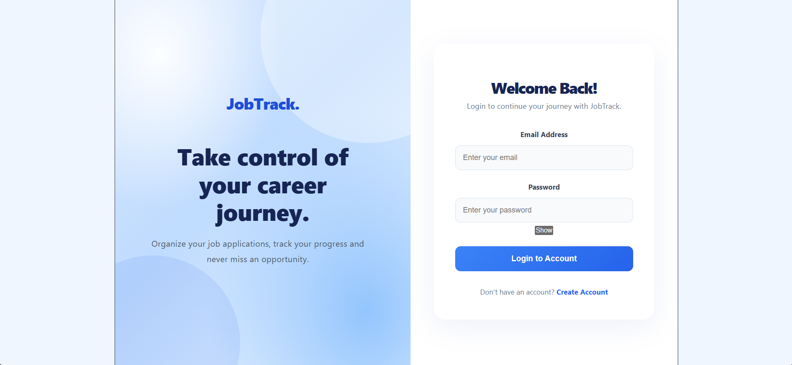
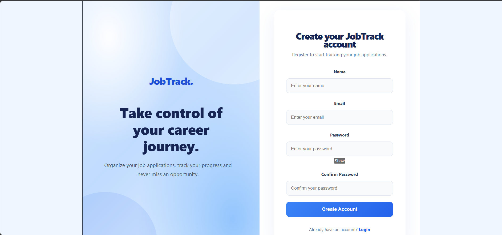
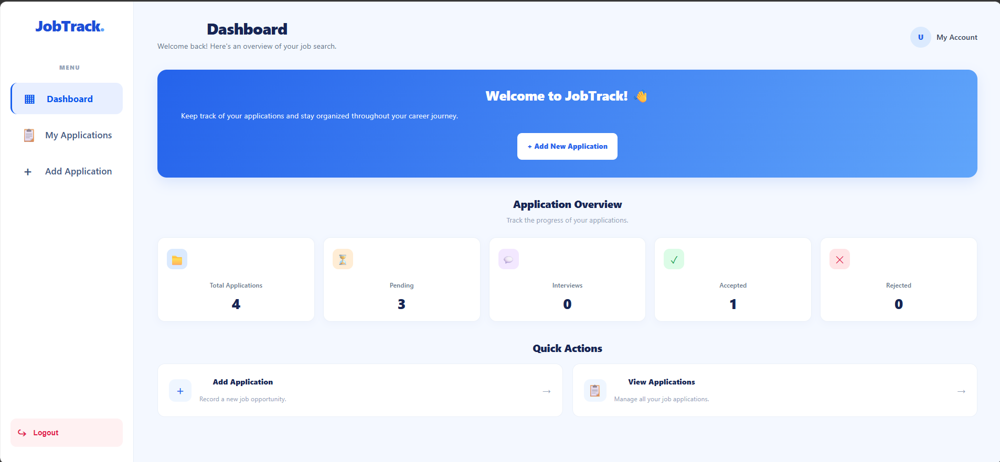

# JobTrack – Job Application Management System

## About the Project

JobTrack is a full-stack web application designed to help users manage and organize their job applications in one place.

## Technologies Used

### Frontend
- React.js
- JavaScript
- CSS
- Vite

### Backend
- PHP
- Laravel
- MySQL

## Main Features

- User authentication
- Job application management
- Add, edit, and delete job applications
- Track application statuses
- User-friendly interface

## Project Structure

```text
JobTrack/
├── backend/
└── frontend/
```

## Installation

### Backend
1. Navigate to the backend folder.
2. Install dependencies:
   `composer install`
3. Configure the `.env` file.
4. Run database migrations:
   `php artisan migrate`
5. Start the Laravel server:
   `php artisan serve`

### Frontend
1. Navigate to the frontend folder.
2. Install dependencies:
   `npm install`
3. Start the development server:
   `npm run dev`

##  Screenshots
### Login

### Register

### Dashboard

### Add Application

### My Applications


## Author

Wiam Bouazizi

Junior Full Stack Web Developer
